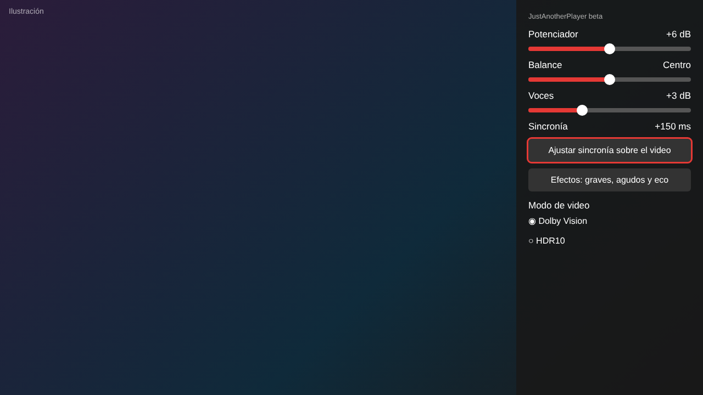
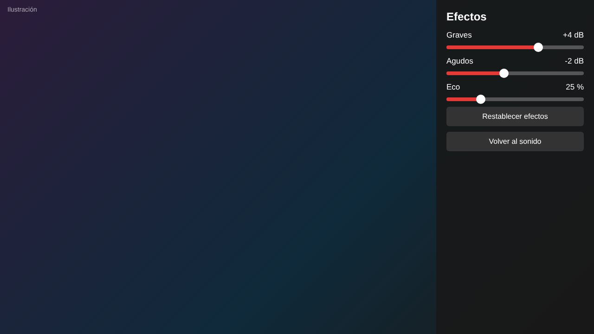
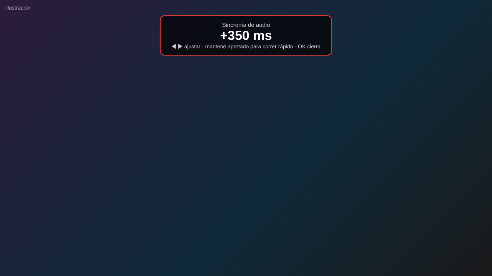
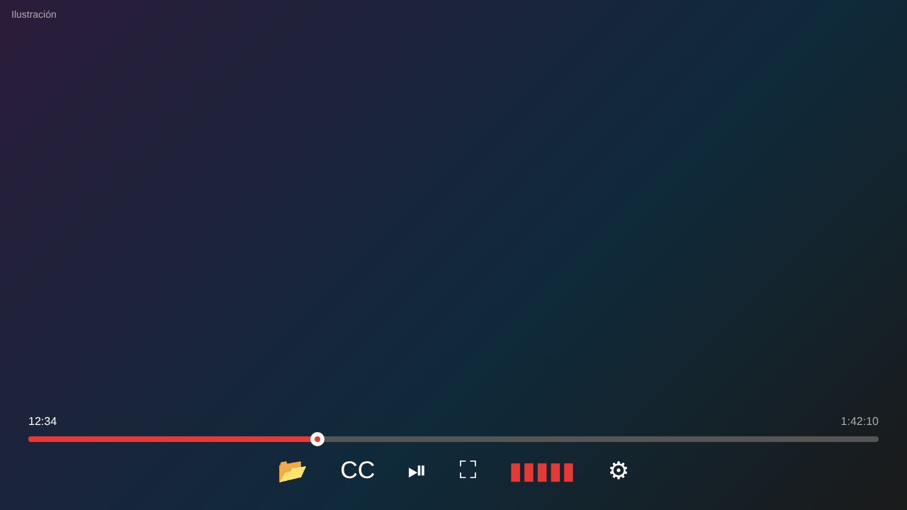

# JustAnotherPlayer

**El reproductor de video para Android TV con panel de sonido propio: potenciador, balance por Bluetooth, voces, graves, agudos, eco, sincronía de audio y elección entre Dolby Vision y HDR10.**

Basado en [Just (Video) Player](https://github.com/moneytoo/Player), de Marcel Dopita (moneytoo), de dominio público. Pensado primero para **Android TV**, y también anda en teléfono.

> Creado por **@Sr.BernS - Bernardo Soage - Corrientes Argentina**

## 🆕 Novedades (lo que no tiene ningún otro reproductor)

### 🔊 Panel de sonido (quinto botón de la barra)
- **Potenciador de volumen por software:** de 0 a +12 dB.
- **Balance izquierda / derecha:** funciona también con **auriculares y parlantes Bluetooth**, donde Android no tiene balance propio, porque lo hace el propio reproductor.
- **Voces:** refuerza el canal central de las películas 5.1 / 7.1, que suele ser donde están los diálogos, y mezcla todo a estéreo.
- **Estéreo siempre:** el audio se decodifica y se mezcla dentro del reproductor, sin pasar a hardware que no lo soporte.
- **Línea de diagnóstico** para ver qué audio está llegando y confirmar que el procesamiento está activo.

### 🎚️ Efectos: graves, agudos y eco
Pantalla propia, abierta desde el panel de sonido. **Graves** y **Agudos** de -12 a +12 dB, y **Eco** de 0 a 100 %. Sin reverb, a propósito, para no hacer lento el procesador en videos 4K.

### ⏱️ Sincronía de audio flotante, de ±3000 ms
Se ajusta como una tira flotante **sobre el video**, para ver los labios mientras corregís. Se mantiene 60 segundos y se cierra con OK. Si mantenés apretado el botón, avanza rápido.

### 🌈 Dolby Vision o HDR10, a elección
Si el archivo trae ambos, elegís cuál reproducir. En HDR10 no hay parpadeo.

### 🎨 Diseño propio
Barra de reproducción roja con punto blanco de centro rojo, íconos rediseñados, **ecualizador animado** en el botón de sonido (se mueve solo mientras reproduce), ajustes oscuros con acento rojo, y la barra se muestra **3 segundos al iniciar cada video**.

*Las imágenes de esta sección son ilustraciones del diseño.*

## Lo que conserva de Just Player

- Pistas de audio y subtítulos, control de velocidad
- Deslizar y doble toque para adelantar/retroceder; brillo y volumen con gestos
- Zoom con pellizco, ajuste de pantalla (ajustar / recortar), Picture in Picture
- Ajuste automático de tasa de cuadros en Android TV
- Formatos: audio (AC3, EAC3, DTS, TrueHD, Opus, FLAC, AAC...), video (H.264, H.265, VP9, AV1...), contenedores MP4, MKV, WebM, TS y más, y streaming DASH, HLS y RTSP
- Sin publicidad, sin rastreo y sin permisos de más

## Instalación

1. Bajá el último APK desde [**Releases → beta**](https://github.com/bersoage/JustAnotherPlayer/releases/tag/beta) (archivo `JustAnotherPlayer-betaN.apk`).
2. Instalalo en el TV o teléfono. Es una app **aparte**: no pisa a Just Player.
3. Abrí un video; el botón de sonido es el quinto de la barra.

En Android TV es práctico pasar el APK por pendrive o con una app como Downloader.

## Estado

Versión beta, en desarrollo. Los cambios se prueban en un TV TCL con audio por Bluetooth. Si algo no anda, abrí un *issue* contando el modelo del dispositivo.

## Créditos y licencia

- Desarrollo y diseño: **@Sr.BernS - Bernardo Soage - Corrientes Argentina**
- Base: [Just (Video) Player](https://github.com/moneytoo/Player) de Marcel Dopita (moneytoo), licencia [Unlicense](LICENSE)
- Motor: [Media3 / ExoPlayer](https://github.com/androidx/media)
